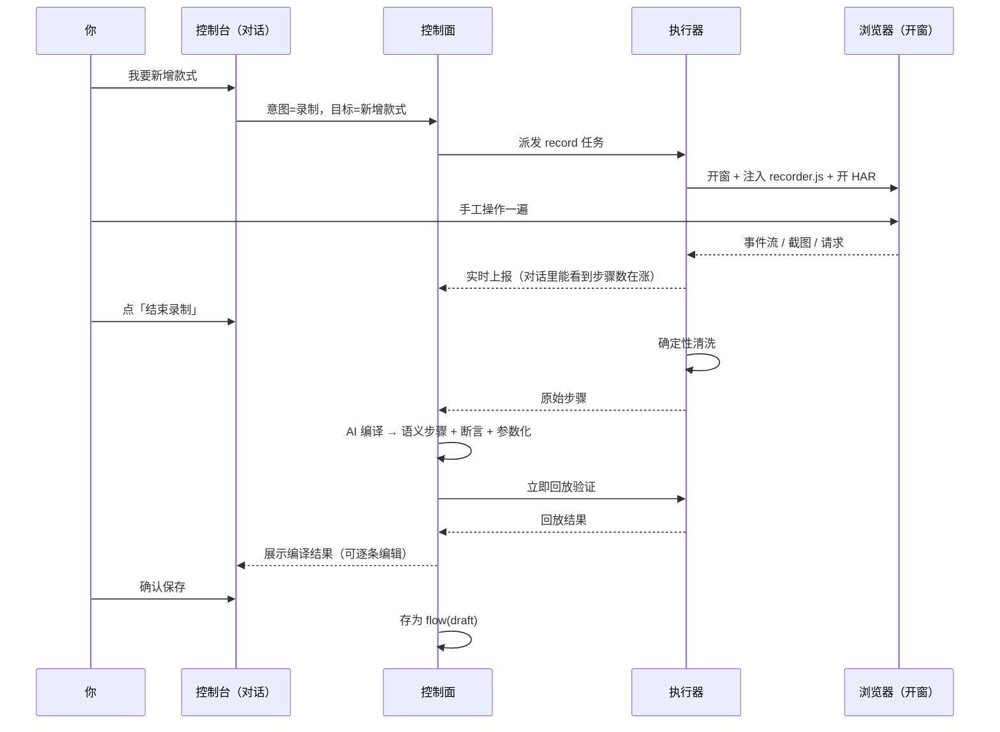

# P1 技术方案：录制回放、依赖自愈、对话入口、页面状态校验

面向四件事：

1. 我说「我要新增款式」，浏览器打开，**我操作一遍**，系统记住，之后说「回归新建款式」就重放。
2. 回放时发现「品类」必填但没数据，**自己去品类维护建一条**，回来接着跑。
3. 控制台改成**对话形式**，现在这种「下拉选流程 + 点执行」不好用。
4. HAR 只能看接口，**看不见表格塌陷、页面高度异常**这类问题。

下面按这四件事给设计，最后是分期与风险。

---

## 0. 三条不能破的约束

后面所有设计都受这三条约束，先说清楚，免得后面看着别扭。

**回放必须是确定性的。** 日常回归零模型调用。AI 只在三个地方介入：录制后编译、失败后诊断、缺依赖时探索。一旦编译出步骤，之后每次跑都是同一份步骤、同一套断言。原因很实际：AI 每次跑都调模型，一是慢和贵，二是**同一条用例两次跑出不同结果，这测试就没有信誉了**。

**AI 的产物必须自证。** 编译出来的步骤，当场回放一遍，跑不过就打回重编译。人确认之后才能进入回归集。AI 说「我理解了你的操作」不算数，回放通过才算数。

**自愈必须留痕且受限。** 系统替你造数据这件事，威力和破坏力一样大。它只能在明确允许的环境、用已确认的夹具、有次数上限、并且在报告里显式标出来。自愈过的运行不能当基线。

---

## 1. 录制：我操作一遍，系统记住

### 1.1 为什么不用 Playwright 自带的 codegen

Playwright 有 `codegen`，但它输出的是 Python/JS 代码。我们要的是**结构化步骤**（现有的 DSL），因为步骤才能被编辑、参数化、做定位漂移检测、被 AI 改写。拿到代码再反解析回结构，是白绕一圈。

所以自建录制器：注入一段 `recorder.js` 到浏览器上下文，采集事件流。

### 1.2 录制时采集什么

开一个 **headed** 浏览器（你要能看见并操作），上下文里同时装三样东西：

| 采集项 | 内容 | 为什么要 |
| --- | --- | --- |
| 交互事件 | click / input / change / Enter / 导航 / 弹窗开合 | 步骤的骨架 |
| 定位候选 | 每个元素算出 testid / role / label / placeholder / text / css 一组候选 | 回放时首选失效可回退，并能报漂移 |
| 语义上下文 | 元素在哪个弹窗、哪个表单、哪行表格；最近的 label 文本；当前菜单路径 | 让 AI 编译时能写出「填写款式编码」而不是「填写第 3 个输入框」 |
| 网络请求 | HAR（含响应体摘要） | 一次录制同时产出接口用例；失败时能对齐「点了什么 → 发了什么 → 返回什么」 |
| 关键截图 | 导航、弹窗开合、提交前后 | 编译时给 AI 看，回放时做基线 |
| 探针数据 | 现有的静默错误探针照常工作 | 录制过程中如果页面本身就有错，当场就知道 |

事件用 **capture 阶段**监听，拿到真实 target；不用冒泡，避免被框架的事件代理吃掉。

### 1.3 噪声是主要难点

原始事件流很脏：每敲一个字符一个 `input` 事件、点开下拉菜单的中间点击、误点、框架内部派发的合成事件。直接存下来回放，又长又脆。

分两步清洗：

**第一步，确定性预处理**（不用 AI）：
- 连续的 `input` 事件按元素合并，失焦或 500ms 无输入时产出**一条** `fill`
- 丢弃不改变 DOM 也不发请求的点击
- 同一元素上的 `pointerdown` + `click` 去重
- 折叠「点开下拉 → 点选项」为一条 `select`

**第二步，AI 编译**（Compiler 角色）。输入输出契约必须写死，不能是「交给 AI」这种说法：

- **输入**：清洗后的事件序列、每步的定位候选、关键截图、相关请求摘要、以及你当初说的那句意图（「我要新增款式」）
- **输出**：严格 JSON，**只能使用 DSL 里已有的动作原语**，附带：
  - 每步的语义 label（「填写款式编码」）
  - 分组：前置准备 / 主流程 / 结果校验
  - 推断出的断言（保存后应出现「操作成功」；列表应新增一行）
  - 标记哪些步骤是 `mutating`（写数据，dry-run 时要跳过）
  - 标记哪些输入值需要**参数化**
- **校验**：先过 DSL schema，再**立即回放一次**。回放不过就带着失败信息打回重编译，最多 3 轮。3 轮不过就把清洗后的步骤原样交给人工编辑。

> **P1.2 观察者第一版**把「第二步」从润色改成编写：录制轨迹是样例，观察者认识字段/组件后出脚本，选值默认任选。见 `docs/p1.2-ai-observer-plan.md`。已落地的 Compiler 仍是「不许改骨架的润色」，见 `docs/p1.2-ai-compiler-plan.md`。

### 1.4 参数化：录制时填 ABC123，回放时不能还填 ABC123

款式编码通常唯一。录制时填的值直接硬编码进步骤，第二次回放必然撞唯一性校验。

DSL 增加变量：

```
{{unique:style_code}}   每次运行生成唯一值，带 AT_ 前缀便于识别和清理
{{now:%Y%m%d}}          时间
{{pick:品类}}           从「品类」实体里挑一条现存数据（连到第 2 节的依赖机制）
{{env:xxx}}             环境相关配置
```

哪些字段该参数化，由 AI 编译时推断（编码类、名称类、有唯一性校验的字段），人在确认界面上可以改。

### 1.5 录制不可能百分百保真

明确列为**本期不支持**，遇到就在录制界面提示「这一段没录上，请手工补步骤」：

- 拖拽排序、canvas 内的操作、原生文件选择框
- iframe 跨域内容
- 复杂富文本编辑器的内部操作
- 依赖真实鼠标轨迹的组件（手写签名、滑块验证）

宁可明说不支持，也不要录出一条似是而非、回放起来时好时坏的用例。

### 1.6 录制的完整链路



---

## 2. 依赖自愈：品类没数据就先去建一个

这是最有价值、也最容易闯祸的功能。核心思路是**把「自愈」变成确定性的夹具调用，而不是让 AI 现场发挥**。

### 2.1 三个概念

**夹具流程（fixture）**：一条职责单一的已确认流程，比如「新建一个品类」。它本身也是录制出来的，走同样的确认流程。

**前置条件（precondition）**：flow 可以声明依赖，例如「需要至少存在一条品类数据」。检查手段是确定性的——调接口数一下，或者打开列表页读表格行数。检查很便宜，可以每次跑之前都做。

**自愈（healing）**：前置条件不满足时，先跑对应的 fixture，再复查，然后继续主流程。

### 2.2 两种触发路径

**路径一：跑之前就发现（首选）**

```
跑「新建款式」
  → 检查前置条件：品类数据存在吗？
      不存在 → 找到 fixture「新建品类」→ 跑 → 复查 → 继续
```

便宜、可预测，应该覆盖大部分情况。

**路径二：跑到一半才撞上**

前置条件没覆盖到的情况。步骤失败了（下拉选项为空、必填校验飘红、接口报错），这时触发 **Reviewer 角色**：

- **输入**：失败步骤上下文、当前截图、DOM 摘要、探针抓到的错误、最近的请求响应
- **输出**：分类结论，四选一
  - `产品缺陷` —— 真问题，报出来
  - `环境数据缺失` —— 缺什么实体，说清楚
  - `用例过期` —— UI 改了，用例该更新
  - `偶发` —— 重试可能就好

只有判定为**环境数据缺失**且能识别出缺哪个实体时，才去查夹具库：
- 有对应 fixture → 挂起主流程 → 跑 fixture → 回到失败步骤重试
- 没有 → 停下，标记 `blocked:missing_fixture`，让 AI Explorer 去探索生成一条候选 fixture，**人确认后**才入库

### 2.3 安全边界（这部分不能省）

自愈是在被测环境里写真实数据，必须卡死：

| 限制 | 做法 |
| --- | --- |
| 环境白名单 | 站点上标 `allow_fixture`，没标的环境一律不自愈 |
| 只用已确认的夹具 | fixture 必须是 reviewed 以上状态，AI 不能即兴执行没人看过的写操作 |
| 次数上限 | 单次运行最多自愈 N 次（默认 3），防止 A 缺 B、B 缺 C 的无限链 |
| 数据可识别 | fixture 造的数据统一带 `AT_` + 时间戳前缀，便于排查和清理 |
| 结论不掺水 | 自愈过的运行标记为 `passed_with_healing`，**不是**干净的 passed，且不能被采纳为基线 |
| 全程留痕 | 事件流里写明「第 7 步因品类无数据失败 → 执行夹具『新建品类』→ 重试第 7 步通过」 |

最后一条尤其重要。自愈如果是隐形的，测试就变成了「反正它自己会搞定」，那么真正的环境问题会被一直掩盖到上线。

---

## 3. 对话入口

### 3.1 对话是入口，不是全部

「选流程 → 点执行」难看，这个判断我同意。但对话也不适合干所有事：配置每晚全量回归、管理基线、看趋势，用对话很难受。

所以：**对话面板作为主入口**，处理「我要做什么」；**列表/表格视图保留**，处理批量和配置。

### 3.2 意图路由

轻量 LLM 调用（Router 角色），把自然语言映射到动作：

| 你说 | 意图 | 系统做什么 |
| --- | --- | --- |
| 我要新增款式 | `record` | 找不到同名流程 → 问你要不要录 → 开窗录制 |
| 回归新建款式 | `replay` | 匹配到流程 → 确认参数 → 执行，直播卡片嵌在对话里 |
| 昨天哪些失败了 | `query` | 查询 + 结果卡片 |
| 为什么这条挂了 | `diagnose` | 调出运行详情 → Reviewer 分析 |
| 把这条设成回归用例 | `manage` | 状态流转 draft → reviewed |

匹配不确定时不要瞎猜，列出候选让你选——这正是 `AskQuestion` 式的结构化选项，比猜错了跑一遍强。

### 3.3 对话里是卡片，不是纯文本

- **录制卡片**：开始/结束按钮、实时步骤计数、当前页面缩略图
- **运行卡片**：就是现在中栏那套步骤直播，做成可折叠卡片
- **编译结果卡片**：AI 给出的步骤列表，逐条可编辑/删除/改断言，确认后保存
- **诊断卡片**：Reviewer 的分类结论 + 证据（截图、请求、探针）

### 3.4 从 work-lucy 拿什么

我读了 `D:\Chaos\work-lucy`。结论是**抽协议和模式，不接服务**。

它是 Bun + Hono + React 19 + Zustand + Tailwind 的全栈应用，和我们的 Python + FastAPI + 静态 HTML 是语言、运行时、前端框架三重不匹配。把它作为子服务挂进来，等于同时维护两套栈。

值得移植的（用 Python 重写）：

| 资产 | 位置 | 价值 |
| --- | --- | --- |
| SSE 两步对话协议 | `server/routes/conversations.ts` | POST 存消息 + GET 流式返回，带心跳保活。我们的运行直播已经是 SSE，形状一致，能合成一套 |
| StepEvent 事件模型 | `server/agent.ts` | `thinking / tool_call / tool_result / done`，正好对应我们要在对话里展示 AI 的思考和动作 |
| 工具循环 Agent 架构 | `server/agent.ts` | 多轮 tool_use → execute → tool_result，含**连续同工具调用检测**（防死循环）和**工具输出截断**（防 context 爆炸）——这两个细节是踩过坑才会加的 |
| 会话 CRUD | `server/conversation.ts` | 结构简单，Python 直接复刻 |
| SSE 客户端解析 | `src/lib/api.ts` | 用 `fetch` + `ReadableStream` 手解析而非 `EventSource`，改写成原生 JS 几十行 |

需要补它没有的：LLM 调用的**超时、重试、token 统计、多模型路由**——它这四样都没有，而我们要按量控成本，必须有。

明确丢弃：Oinone/Pamirs 的 prompt 范式、RAG 那套代码检索、Editor 和 Terminal 页面（浏览器里开 shell，安全风险高且我们不需要）、React 聊天 UI（我们不引 React）。另外它的 CORS 是全开的且没有任何鉴权，这个不能抄。

---

## 4. 页面状态校验：HAR 看不见的那部分

HAR 只有请求和响应。表格塌陷、容器高度为 0、按钮跑出视口、文字被截断——接口全是 200，HAR 一片绿。

分三层，成本从低到高：

### 4.1 确定性布局探针（主力，零模型调用）

扩展现有的 `pageHealth`，在页面里用 JS 算，便宜、稳定、可解释，能在全量回归里逐页跑：

| 检查 | 判据 |
| --- | --- |
| 容器塌陷 | 元素有子节点，自身高度却小于阈值 |
| 表格异常 | thead 有列但 tbody 高度为 0；行高异常；表格容器高度不足以显示一行 |
| 内容溢出 | `scrollWidth > clientWidth` 且有文本被裁 |
| 元素重叠 | 关键元素的 boundingBox 相交 |
| 跑出视口 | 关键按钮的 boundingBox 落在视口外 |
| 页面空白 | 视口内可见内容的像素占比过低 |

「关键元素」哪来？录制的时候就知道了——你操作过的元素天然就是关键元素。

### 4.2 截图基线比对

golden 跑固化基线，之后回归做**分块结构化 diff**（不是全图逐像素，那个噪声太大）。必须支持 **mask 区域**：时间、数据条数、头像这些天天变的地方要能屏蔽，否则天天误报，两周后就没人看了。

### 4.3 AI 视觉复核（只在前两层报警时）

多模态模型看基线图 + 当前图 + diff 热区，判断三选一：`布局坏了` / `只是数据变化` / `预期内的改版`。

它的作用是**压误报**，不是发现问题。发现问题是前两层的事。

### 4.4 和 HAR 的关系

录制时同时抓 HAR，UI 事件和网络请求落在**同一条时间轴**上。失败时你能一次看到：点了哪个按钮 → 发了什么请求 → 返回了什么 → 页面变成什么样 → 布局有没有塌。

而且一次录制同时产出两份资产：UI 回放流程 + L1 接口用例。之前那套单独录 HAR 的做法，可以并进来。

---

## 5. 分期

| 阶段 | 内容 | 交付标准 |
| --- | --- | --- |
| **P1.0** | 站点接入搬进控制台（不再敲命令行） | 页面上填地址 → 执行器打开页面识别登录表单 → 填账号密码 → 存凭证建流程 |
| **P1.1** | 录制回放（**不带 AI**） | 开窗录制 → 确定性清洗 → 控制台逐条确认 → 存 flow → 回放通过 |
| **P1.2** | AI 编译 | 语义 label、断言推断、参数化；编译产物必须自证可回放 |
| **P1.3** | 布局探针 L1 | 六类确定性检查进 pageHealth；可与 P1.1 并行，互不依赖 |
| **P1.4** | 对话入口 | Router 意图识别 + 对话面板 + 卡片；录制/回放/查询接进去 |
| **P1.5** | 视觉基线 + AI 复核 | 基线固化、mask、diff、多模态复核 |
| **P1.6** | 依赖自愈 | 夹具库、前置条件、Reviewer 分类、安全边界 |

**P1.1 先于一切**。录制-回放闭环如果不成立，后面全是空中楼阁；它成立了，AI 那层才有意义。

**P1.6 放最后**，因为它风险最高：要往真实环境写数据，而且依赖前面所有环节（夹具本身要靠录制产出，判断要靠 Reviewer，安全要靠 flow 状态机）。

P1.0 是对「让我点，别让我敲命令」的直接回应，成本最低，可以立刻做。

---

## 6. 风险清单

| 风险 | 应对 |
| --- | --- |
| 录制录不全（拖拽、canvas、iframe） | 明确列为不支持，录制界面提示手工补，不产出似是而非的用例 |
| AI 编译出错 | 强制「编译即回放验证」+ 人确认才能进回归集 |
| 参数化漏判导致唯一性冲突 | 回放失败时 Reviewer 优先怀疑这一类；确认界面把参数化字段高亮出来让人核对 |
| 自愈造脏数据 | 环境白名单 + 数据前缀 + 次数上限 + 不能升基线 |
| 自愈掩盖真实环境问题 | 结论标 `passed_with_healing`，报告里单独统计，自愈频次本身就是一个要看的指标 |
| 视觉基线噪声 | 必须支持 mask；宁可少报也不要天天误报 |
| 模型成本 | 录制编译和失败诊断才调模型，日常回归零调用；补 token 统计与预算上限 |
| 对话交互不适合批量 | 列表视图保留，不强推对话 |

---

## 7. 需要你定的几件事

1. **先做 P1.0 还是直接上 P1.1？** P1.0 成本很低（大半天），但如果你更想早点看到录制，可以跳过它先做录制。
2. **多模态模型走哪个网关？** 之前定的公司统一网关，需要确认它支持图片输入——不支持的话 4.3 的视觉复核要另找路子。
3. **自愈的写权限给到哪个环境？** 建议先只在一个专用测试环境开，观察一段时间再放开。
4. **「品类」这类实体清单从哪来？** 是手工维护，还是从菜单结构自动发现？这决定了夹具库的组织方式。
